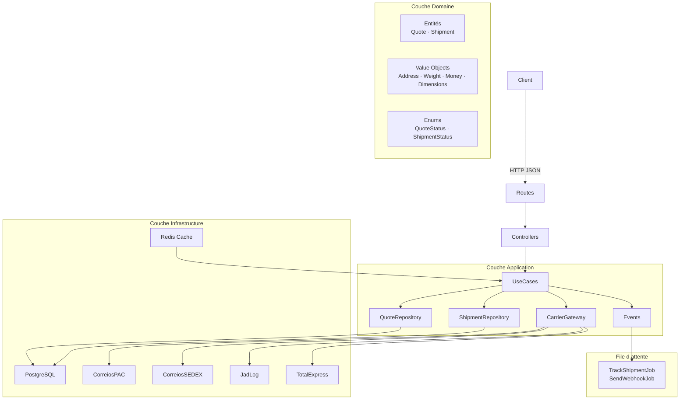

# FreteHub API


> [Read in English](README.md) · [Leia em Português](README.pt.md)

API REST de devis et gestion d'expéditions multi-transporteurs, construite avec **Laravel 12**, **Clean Architecture**, **Docker** et **Pest PHP**.

---

## Fonctionnalités

- Devis simultanés auprès de plusieurs transporteurs (Correios PAC/SEDEX, JadLog, TotalExpress)
- Cache Redis automatique des devis pendant 1 heure
- Confirmation d'expédition avec génération automatique du code de suivi
- Mises à jour du statut de suivi en temps réel via des jobs en file d'attente
- Webhooks avec signature HMAC-SHA256 et relance automatique
- Authentification via Laravel Sanctum
- Documentation interactive Swagger UI

---

## Architecture



---

## Endpoints

| Méthode  | Endpoint                          | Auth | Description                              |
|----------|-----------------------------------|------|------------------------------------------|
| `POST`   | `/api/v1/auth/register`           | —    | Créer une nouvelle boutique              |
| `POST`   | `/api/v1/auth/login`              | —    | Connexion et génération de token         |
| `POST`   | `/api/v1/auth/logout`             | ✓    | Révoquer le token actuel                 |
| `POST`   | `/api/v1/quotes`                  | ✓    | Créer un devis multi-transporteurs       |
| `POST`   | `/api/v1/shipments`               | ✓    | Confirmer une expédition depuis un devis |
| `GET`    | `/api/v1/shipments/{id}/tracking` | ✓    | Suivre une expédition                    |
| `POST`   | `/api/v1/webhooks`                | ✓    | Configurer un webhook                    |
| `DELETE` | `/api/v1/webhooks`                | ✓    | Supprimer un webhook                     |
| `GET`    | `/api/health`                     | —    | Santé de l'application (DB + Redis)      |
| `GET`    | `/api/documentation`              | —    | Swagger UI                               |

> Routes authentifiées : throttle de **60 req/min**.

---

## Installation en 1 commande

```bash
git clone https://github.com/votre-utilisateur/fretehub.git && cd fretehub && cp .env.example .env && docker compose up -d && docker compose exec app php artisan migrate --seed
```

### Étape par étape

```bash
# 1. Cloner et accéder au répertoire
git clone https://github.com/votre-utilisateur/fretehub.git
cd fretehub

# 2. Copier les variables d'environnement
cp .env.example .env

# 3. Démarrer les conteneurs (app, postgres, redis, queue, scheduler)
docker compose up -d

# 4. Lancer les migrations et les seeders
docker compose exec app php artisan migrate --seed

# 5. Générer la documentation Swagger
docker compose exec app php artisan l5-swagger:generate
```

L'API sera disponible sur **http://localhost:8000** et Swagger sur **http://localhost:8000/api/documentation**.

---

## Variables d'Environnement

| Variable           | Description                      | Défaut     |
|--------------------|----------------------------------|------------|
| `APP_ENV`          | Environnement de l'application   | `local`    |
| `DB_HOST`          | Hôte PostgreSQL                  | `postgres` |
| `DB_DATABASE`      | Nom de la base de données        | `fretehub` |
| `DB_USERNAME`      | Utilisateur de la base           | `fretehub` |
| `DB_PASSWORD`      | Mot de passe de la base          | `secret`   |
| `REDIS_HOST`       | Hôte Redis                       | `redis`    |
| `QUEUE_CONNECTION` | Driver de file d'attente         | `redis`    |

---

## Tests

```bash
# Lancer tous les tests
docker compose exec app php artisan test

# Avec rapport de couverture (>= 80%)
docker compose exec app php artisan test --coverage --min=80
```

---

## Qualité du Code

```bash
# PHPStan niveau 8
docker compose exec app ./vendor/bin/phpstan analyse

# Laravel Pint (style de code)
docker compose exec app ./vendor/bin/pint
```

---

## Transporteurs (Mock)

| Transporteur | Service  | Formule de base           | Délai de base |
|--------------|----------|---------------------------|---------------|
| Correios     | PAC      | poids × R$3,50 + R$8,00   | 7 jours       |
| Correios     | SEDEX    | poids × R$7,00 + R$15,00  | 2 jours       |
| JadLog       | Expresso | poids × R$4,20 + R$6,50   | 5 jours       |
| TotalExpress | Standard | poids × R$5,00 + R$5,00   | 3 jours       |

> Tous les transporteurs appliquent une variation aléatoire de ±10% et ont 5% de chance de simuler une panne.

---

## Décisions Architecturales

| Décision | Raison |
|----------|--------|
| Clean Architecture | Découple les règles métier des frameworks — facilite les tests et la maintenance |
| Strategy Pattern pour les transporteurs | Ajouter un nouveau transporteur sans modifier le code existant (OCP) |
| UUID pour quotes et shipments | Les IDs publics ne doivent pas être séquentiels (sécurité) |
| Money en centimes (int) | Évite les erreurs de virgule flottante dans les calculs financiers |
| Jobs pour les webhooks | Résilience : relance automatique sans bloquer la requête HTTP |
| Cache Redis par hash des paramètres | Évite d'interroger les transporteurs plusieurs fois pour la même route/poids |

---

## Licence

MIT
