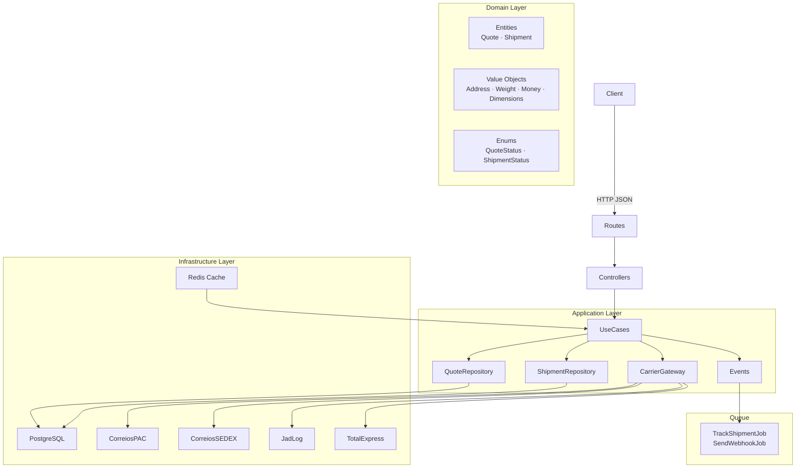

# FreteHub API


> [Leia em Português](README.pt.md) · [Lire en Français](README.fr.md)

A multi-carrier freight quoting and management REST API built with **Laravel 12**, **Clean Architecture**, **Docker**, and **Pest PHP**.

---

## Features

- Simultaneous quotes from multiple carriers (Correios PAC/SEDEX, JadLog, TotalExpress)
- Automatic Redis cache for quotes (1-hour TTL)
- Shipment confirmation with automatic tracking code generation
- Real-time tracking status updates via queued jobs
- Webhooks with HMAC-SHA256 signing and automatic retry
- Authentication via Laravel Sanctum
- Interactive Swagger UI documentation

---

## Architecture



---

## Endpoints

| Method   | Endpoint                          | Auth | Description                        |
|----------|-----------------------------------|------|------------------------------------|
| `POST`   | `/api/v1/auth/register`           | —    | Register a new store               |
| `POST`   | `/api/v1/auth/login`              | —    | Login and token generation         |
| `POST`   | `/api/v1/auth/logout`             | ✓    | Revoke current token               |
| `POST`   | `/api/v1/quotes`                  | ✓    | Create a multi-carrier quote       |
| `POST`   | `/api/v1/shipments`               | ✓    | Confirm shipment from a quote      |
| `GET`    | `/api/v1/shipments/{id}/tracking` | ✓    | Track a shipment                   |
| `POST`   | `/api/v1/webhooks`                | ✓    | Configure webhook                  |
| `DELETE` | `/api/v1/webhooks`                | ✓    | Remove webhook                     |
| `GET`    | `/api/health`                     | —    | Application health (DB + Redis)    |
| `GET`    | `/api/documentation`              | —    | Swagger UI                         |

> Authenticated routes: throttle **60 req/min**.

---

## One-command Setup

```bash
git clone https://github.com/your-username/fretehub.git && cd fretehub && cp .env.example .env && docker compose up -d && docker compose exec app php artisan migrate --seed
```

### Step by step

```bash
# 1. Clone and enter the directory
git clone https://github.com/your-username/fretehub.git
cd fretehub

# 2. Copy environment variables
cp .env.example .env

# 3. Start containers (app, postgres, redis, queue, scheduler)
docker compose up -d

# 4. Run migrations and seeders
docker compose exec app php artisan migrate --seed

# 5. Generate Swagger documentation
docker compose exec app php artisan l5-swagger:generate
```

The API will be available at **http://localhost:8000** and Swagger at **http://localhost:8000/api/documentation**.

---

## Environment Variables

| Variable           | Description                | Default    |
|--------------------|----------------------------|------------|
| `APP_ENV`          | Application environment    | `local`    |
| `DB_HOST`          | PostgreSQL host            | `postgres` |
| `DB_DATABASE`      | Database name              | `fretehub` |
| `DB_USERNAME`      | Database user              | `fretehub` |
| `DB_PASSWORD`      | Database password          | `secret`   |
| `REDIS_HOST`       | Redis host                 | `redis`    |
| `QUEUE_CONNECTION` | Queue driver               | `redis`    |

---

## Tests

```bash
# Run all tests
docker compose exec app php artisan test

# With coverage report (>= 80%)
docker compose exec app php artisan test --coverage --min=80
```

---

## Code Quality

```bash
# PHPStan level 8
docker compose exec app ./vendor/bin/phpstan analyse

# Laravel Pint (code style)
docker compose exec app ./vendor/bin/pint
```

---

## Carriers (Mock)

| Carrier      | Service  | Base formula              | Base deadline |
|--------------|----------|---------------------------|---------------|
| Correios     | PAC      | weight × R$3.50 + R$8.00  | 7 days        |
| Correios     | SEDEX    | weight × R$7.00 + R$15.00 | 2 days        |
| JadLog       | Expresso | weight × R$4.20 + R$6.50  | 5 days        |
| TotalExpress | Standard | weight × R$5.00 + R$5.00  | 3 days        |

> All carriers apply a random ±10% variation and have a 5% simulated failure chance.

---

## Architectural Decisions

| Decision | Reason |
|----------|--------|
| Clean Architecture | Decouples business rules from frameworks — easier to test and maintain |
| Strategy Pattern for carriers | Add a new carrier without modifying existing code (OCP) |
| UUID for quotes and shipments | Public IDs must not be sequential (security) |
| Money as cents (int) | Avoids floating-point errors in financial calculations |
| Jobs for webhooks | Resilience: automatic retry without blocking the HTTP request |
| Redis cache by parameter hash | Avoids querying carriers repeatedly for the same route/weight |

---

## License

MIT
