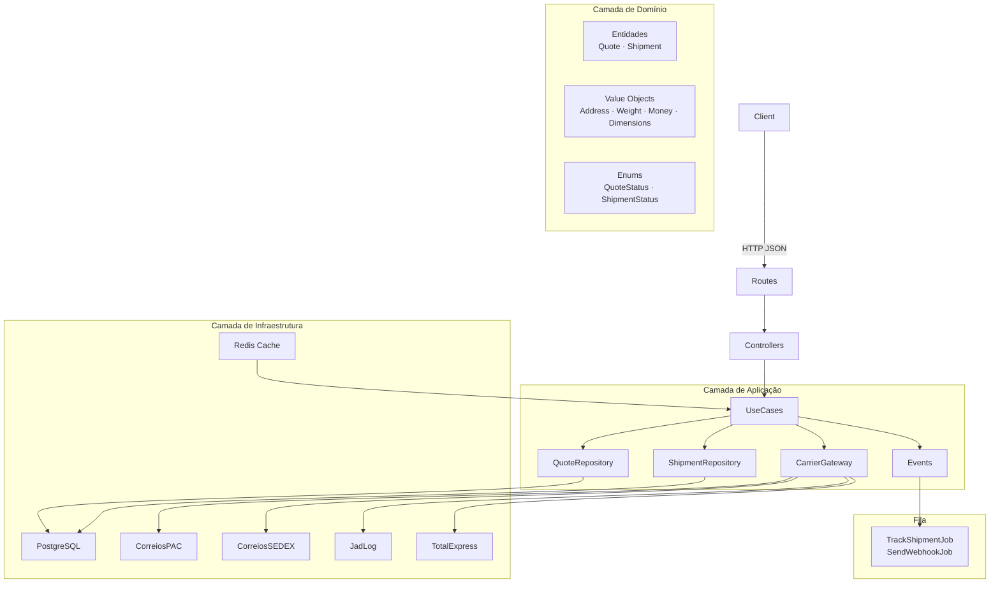

# FreteHub API


> [Read in English](README.md) · [Lire en Français](README.fr.md)

API REST de cotação e gestão de fretes multi-transportadora, construída com **Laravel 12**, **Clean Architecture**, **Docker** e **Pest PHP**.

---

## Funcionalidades

- Cotação simultânea em múltiplas transportadoras (Correios PAC/SEDEX, JadLog, TotalExpress)
- Cache Redis automático de cotações por 1 hora
- Confirmação de envio com geração automática de código de rastreamento
- Atualização de status de rastreamento em tempo real via jobs na fila
- Webhooks com assinatura HMAC-SHA256 e retry automático
- Autenticação via Laravel Sanctum
- Documentação interativa Swagger UI

---

## Arquitetura



---

## Endpoints

| Método   | Endpoint                          | Auth | Descrição                          |
|----------|-----------------------------------|------|------------------------------------|
| `POST`   | `/api/v1/auth/register`           | —    | Registrar nova loja                |
| `POST`   | `/api/v1/auth/login`              | —    | Login e geração de token           |
| `POST`   | `/api/v1/auth/logout`             | ✓    | Revogar token atual                |
| `POST`   | `/api/v1/quotes`                  | ✓    | Criar cotação multi-transportadora |
| `POST`   | `/api/v1/shipments`               | ✓    | Confirmar envio de uma cotação     |
| `GET`    | `/api/v1/shipments/{id}/tracking` | ✓    | Rastrear envio                     |
| `POST`   | `/api/v1/webhooks`                | ✓    | Configurar webhook                 |
| `DELETE` | `/api/v1/webhooks`                | ✓    | Remover webhook                    |
| `GET`    | `/api/health`                     | —    | Saúde da aplicação (DB + Redis)    |
| `GET`    | `/api/documentation`              | —    | Swagger UI                         |

> Rotas autenticadas: throttle de **60 req/min**.

---

## Setup em 1 comando

```bash
git clone https://github.com/seu-usuario/fretehub.git && cd fretehub && cp .env.example .env && docker compose up -d && docker compose exec app php artisan migrate --seed
```

### Passo a passo

```bash
# 1. Clonar e entrar no diretório
git clone https://github.com/seu-usuario/fretehub.git
cd fretehub

# 2. Copiar variáveis de ambiente
cp .env.example .env

# 3. Subir containers (app, postgres, redis, queue, scheduler)
docker compose up -d

# 4. Migrar banco e popular seeders
docker compose exec app php artisan migrate --seed

# 5. Gerar documentação Swagger
docker compose exec app php artisan l5-swagger:generate
```

A API estará disponível em **http://localhost:8000** e o Swagger em **http://localhost:8000/api/documentation**.

---

## Variáveis de Ambiente

| Variável           | Descrição                  | Padrão     |
|--------------------|----------------------------|------------|
| `APP_ENV`          | Ambiente da aplicação      | `local`    |
| `DB_HOST`          | Host do PostgreSQL         | `postgres` |
| `DB_DATABASE`      | Nome do banco              | `fretehub` |
| `DB_USERNAME`      | Usuário do banco           | `fretehub` |
| `DB_PASSWORD`      | Senha do banco             | `secret`   |
| `REDIS_HOST`       | Host do Redis              | `redis`    |
| `QUEUE_CONNECTION` | Driver de filas            | `redis`    |

---

## Testes

```bash
# Rodar todos os testes
docker compose exec app php artisan test

# Com relatório de cobertura (≥ 80%)
docker compose exec app php artisan test --coverage --min=80
```

---

## Qualidade de Código

```bash
# PHPStan nível 8
docker compose exec app ./vendor/bin/phpstan analyse

# Laravel Pint (estilo de código)
docker compose exec app ./vendor/bin/pint
```

---

## Transportadoras (Mock)

| Transportadora | Serviço  | Fórmula base            | Prazo base |
|----------------|----------|-------------------------|------------|
| Correios       | PAC      | peso × R$3,50 + R$8,00  | 7 dias     |
| Correios       | SEDEX    | peso × R$7,00 + R$15,00 | 2 dias     |
| JadLog         | Expresso | peso × R$4,20 + R$6,50  | 5 dias     |
| TotalExpress   | Standard | peso × R$5,00 + R$5,00  | 3 dias     |

> Todas aplicam variação aleatória de ±10% e 5% de chance de falha simulada.

---

## Decisões Arquiteturais

| Decisão | Motivo |
|---------|--------|
| Clean Architecture | Separa regras de negócio de frameworks — facilita testes e manutenção |
| Strategy Pattern para carriers | Adicionar nova transportadora sem alterar código existente (OCP) |
| UUID para quotes e shipments | IDs públicos não devem ser sequenciais (segurança) |
| Money em centavos (int) | Evita erros de ponto flutuante em cálculos financeiros |
| Jobs para webhooks | Resiliência: retry automático sem bloquear a request HTTP |
| Cache Redis por hash dos parâmetros | Evita consultar carriers repetidamente para a mesma rota/peso |

---

## Licença

MIT
